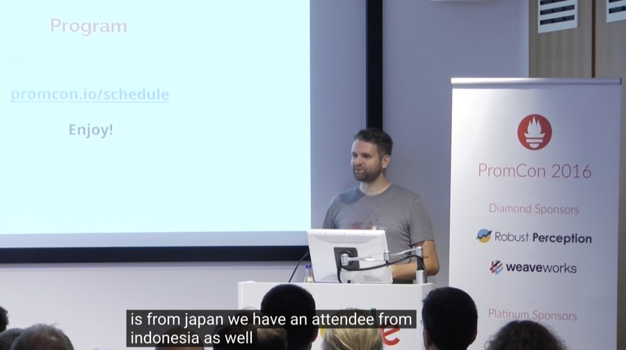
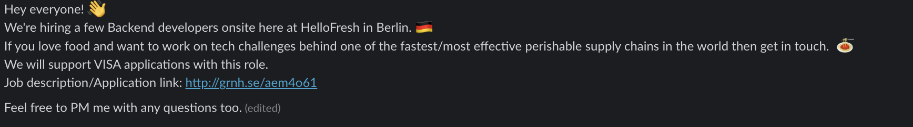
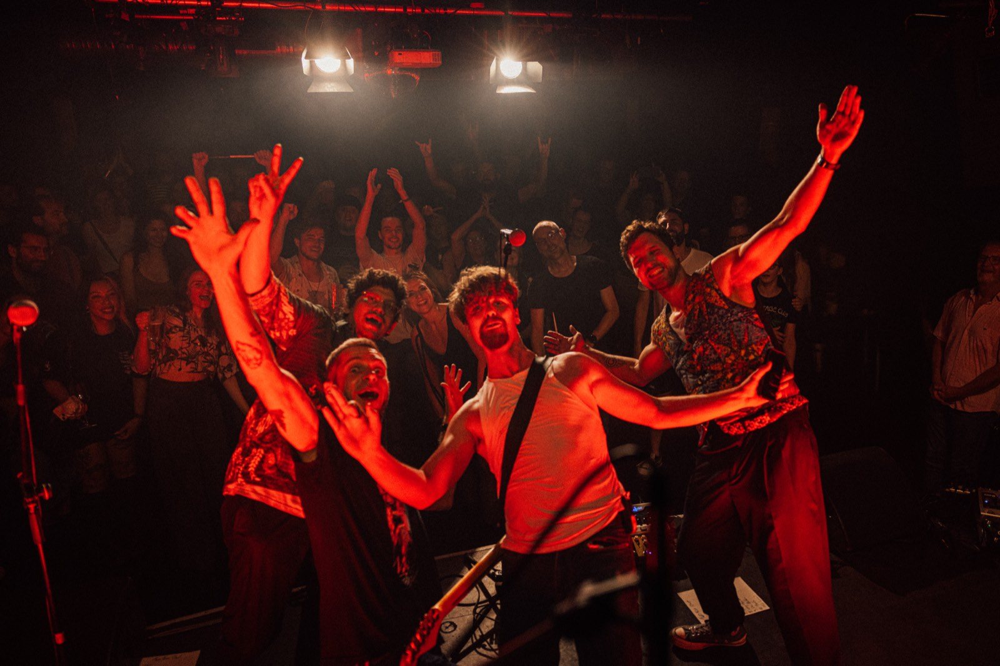

People sometimes ask me how I ended up living in Germany.

It's a bit of a random story, actually. It involves a Go meetup in Jakarta, a diplomat learning to code, an open-source project, and a Slack message.

# A Go meetup in Jakarta

Back around 2015 or 2016, I was a software engineer in Jakarta, Indonesia. I was quite active in the local Go programming community, where I met [Laurie Malau](https://lauriemalau.com/). She was working as a diplomat at the time and was interested in learning how to code. We became friends and kept in touch through Facebook Messenger.

At that point in my life, I was obsessed with the idea of working in the music technology industry. SoundCloud was one of my dream companies. I kept applying to companies like that, but the rejections kept coming.

Laurie happened to know [Julius Volz](https://juliusv.com/), who had worked at SoundCloud, and she introduced us on Facebook.

Honestly, I wanted to talk to Julius because of SoundCloud. So I looked up what he was working on, an open-source project called [Prometheus](https://prometheus.io/), and used it as an excuse to chat. But our conversations took a different direction.

He was kind enough to point me toward some GitHub issues and help me figure out how to contribute. Eventually, I managed to ship what felt like my first big open-source contribution.

Looking back, it was probably a small thing for him to do. But for me, it turned into a *big deal*.

# PromCon 2016

Then came PromCon 2016, the very first Prometheus conference, held in Berlin.

I was so excited about contributing to an open-source project that I decided to fly all the way from Indonesia to attend.

It was my first time in Europe. I got a 15-day tourist visa and used 14 days of it. I landed in Munich, flew to Berlin the next day, and spent 5 days there. The rest I travelled around a bit, to Prague, Ljubljana, Venice, and Verona.

PromCon was also the first time I met Julius in person.

I remember being in a room full of incredibly smart engineers, understanding probably half of what was going on, if even that. I was probably the dumbest person in the room.

But I was *absolutely* psyched.

In fact, during the conference, Julius even mentioned that there was an attendee from Indonesia. *That was me.*

*You can hear it in the [PromCon 2016 recording](https://www.youtube.com/watch?v=-JkxB0CiMjU&t=544s).*

Being surrounded by people who were building things like Prometheus was incredibly exciting. It made me think that maybe Berlin was somewhere I wanted to be.

Until then, I'd been focusing on getting a job at a music technology company. But after PromCon, my thinking changed.

"Let me just get any job in Berlin, and we'll figure it out."

# A Slack message

A few months later, on January 12, 2017, I came across a message in the `#jobs` channel of the Gophers Slack community. Someone from HelloFresh was looking for backend engineers in Berlin, and the company was willing to support visa applications.

*The post in `#jobs` on the Gophers Slack, January 12, 2017.*

HelloFresh wasn't my first try at interviewing abroad, though. I had done a few before, and failed a lot. At some point, Laurie asked me how I prepared for my interviews. I told her I just winged it.

She told me I had to prepare:

> Write down what you're going to say, even though you're not going to read it during the interview. It gives you a better mindset, so you don't think too much during the interview.

So I did. And since then, all my interviews got better.

I applied, went through the interview process, and got an offer.

I was 23, a bit YOLO, and didn't really think twice about it.

I accepted the offer and told my parents I was leaving Indonesia for Germany.

They were understandably confused. They didn't even know I could speak English, let alone German. *How was I supposed to survive in a country so far away?*

I didn't really have an elaborate plan either. I just figured things would work out.

In May 2017, I moved to Berlin and started working at HelloFresh.

And that's how I ended up in Germany.

It wasn't some carefully planned career move. I just wanted to work in music technology, met some interesting people along the way, got involved in open source, attended a conference, and eventually found a job in a city I wanted to live in.

All because I showed up at a Go meetup in Jakarta and got curious about what other people were building.

---

Almost 10 years later, I'm still in Berlin. Not working for a music company, but at least I'm in a band: [Two Fox Out](https://www.twofoxout.com/).

